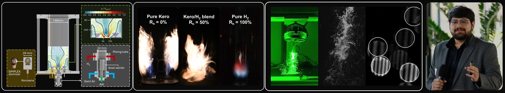

<!-- GitHub Profile README for kadave01 -->

  

<h1 align="center">Hi, I'm Kaushal Dave</h1>

  <em>Combustion Engineer | Guest Researcher at TU Delft | Hydrogen &amp; fuel-flexible combustion, spray diagnostics</em>

---

## 👤 About Me

I am a combustion engineer specializing in fuel-flexible and multiphase combustion, from injector design to test-rig results. At TU Delft since 2020, I co-developed a flashback-resistant CH4-H2 dual-fuel combustor in the APPU project, and for my PhD in the Horizon Europe project HOPE I designed, built and tested a multi-fuel kerosene-H2 combustor and its injector, now a granted Dutch patent. Before research, I spent three years in industry on utility-scale power plant performance and feasibility studies.

I am currently looking for roles in combustion and energy-system development, particularly hydrogen, low-carbon fuels and clean industrial heat.

I am passionate about education and committed to making science more accessible, inclusive and transparent, especially for researchers from resource-constrained communities around the world.

## 🔬 Research Interests

My work centers on experimental development of next-generation combustors, with a strong emphasis on bringing H2 into the energy mix for propulsion and power. I combine test-rig design and campaigns with flame, emission and spray diagnostics, including novel low-cost spray diagnostic techniques, and with low-order and chemical reactor network (CRN) models that support early-stage design.

I strongly believe in open-source science and use and promote open-source tools in my research: <strong>Cantera</strong> for CRN analysis of combustion chemistry and pollutant formation, and <strong>OpenCV</strong> for image processing in droplet diagnostics, enabling accessible, transparent and reproducible workflows in experimental combustion research.

---

## 🎓 Education

- **MSc in Aerospace Engineering (Power & Propulsion)** – TU Delft, Netherlands (2018–2020)  
  *CGPA: 8.25/10* · Thesis on the HYCOS zero-emission H2 power cycle (NVV Combustion Award)
- **B.Tech in Mechanical Engineering** – VJTI, Mumbai, India (2011–2015)  
  *CGPA: 8.1/10*

---

## 💼 Experience

- **TU Delft**, *Netherlands* – Guest Researcher (Oct 2026 – Present)  
  Draft PhD thesis submitted to the doctoral committee; finalizing publications from the HOPE project.

- **TU Delft**, *Netherlands* – PhD Candidate (Oct 2022 – Sep 2026)  
  Designed, built and commissioned a multi-fuel combustor test rig and a novel kerosene-H2 injector (granted patent) in the Horizon Europe HOPE project. Ran test campaigns showing stable operation across the full fuel range up to 100% H2, with emission and flame characterization. Developed open-source Mie/IPI spray diagnostics and CRN models of emission pathways. Supervised MSc students.

- **TU Delft**, *Netherlands* – Researcher (Dec 2020 – Sep 2022)  
  Co-developed a flashback-resistant, swirl-stabilized CH4-H2 dual-fuel combustor and its experimental facility in the APPU project. Coordinated experimental work with industrial partners and co-supervised MSc theses.

- **Feedback Infra Pvt. Ltd.**, *India* – Mechanical Engineer (Aug 2015 – Jul 2018)  
  Engineering consultant for utility-scale coal- and gas-fired power plants in India, Indonesia and Africa: thermodynamic performance assessments, feasibility studies, EPC proposals and in-house performance-monitoring tools.

---

## 🛠 Skills & Tools

- **Experimentation:** Combustion test-rig design, commissioning and test campaigns
- **Diagnostics – Combustion:** PIV, chemiluminescence, exhaust-gas analysis, PLIF
- **Diagnostics – Spray:** Mie-scattering imaging, IPI, shadowgraphy
- **CRN Modelling:** Cantera (Python), Ansys Chemkin-Pro
- **Performance Modelling:** GSP, MATLAB, Python, Excel
- **Image Processing:** OpenCV (Python)
- **Design & CAD:** SolidWorks
- **Languages:** English, Hindi, Gujarati and Marathi (proficient); Dutch (A2, actively improving)

---

## 🏆 Awards & Grants

- CYPHER COST Action YRI Conference Grant – 41st International Symposium on Combustion, Kyoto, 2026
- [DSCI Best Poster Prize – 2025](https://www.linkedin.com/feed/update/urn:li:activity:7389977402568949761/)
- [Best TU Delft H2 Platform paper – 2023](https://www.tudelft.nl/en/2024/tu-delft/tu-delft-presents-the-nine-best-climate-action-energy-papers)
- [NVV Combustion Award 2021 for the best MSc thesis in combustion technology](https://research.tudelft.nl/en/prizes/nvv-combustion-award-2021-for-msc-thesis-titled-feasibility-analy)

---

## 📚 Research Projects

#### HOPE Project | TU Delft – Sustainable Aircraft Propulsion Research Group (2022 – Present)
- [Horizon Europe project](https://cordis.europa.eu/project/id/101096275); my work focuses on a fuel-flexible kerosene-H2 combustor.
- Designed the multi-phase, multi-fuel injector (Dutch patent NL 2039989) and the atmospheric test rig to evaluate it.
- Characterized flame behaviour and pollutant emissions from pure kerosene to 100% H2, and studied the chemistry with CRN models.

#### APPU Project | TU Delft – Power and Propulsion Research Group (2020 – 2022)
- A novel aircraft propulsion concept to reduce local emissions and integrate an “energy mix” for aviation, based on a multifunctional H2-fuelled gas turbine replacing traditional APUs and powering a variable-pitch open rotor in a BLI configuration.
- Contributed to the development of the experimental test rig for a low-NOx swirl-stabilized premixed CH4-H2 combustor.

#### HYCOS zero-emission H2 power cycle | TU Delft – Power and Propulsion Research Group (2019 – 2020)
- Proposed a combustion-based zero-emission power cycle as an alternative to fuel-cell-based distributed power generation.
- Conducted thermodynamic and combustion analyses of an H2/O2-fuelled s-CO2 cycle.
- Published in *Cell Reports Physical Sciences* (2023); received the NVV Combustion Award and the TU Delft H2 Platform best paper award.

#### Multi tubes-in-tube HEX for an MRJT cryocooler | IIT Bombay – Refrigeration & Cryogenics Group and VJTI – Mechanical Department (2014 – 2015)
- Developed a new compact heat exchanger for an MRJT cryocooler.
- Achieved over 65% reduction in size and weight compared with the previous design, improving thermal performance and halving cooldown time.
- Covered all phases from literature survey, thermal and mechanical design to production and testing, reaching 116 K in lab experiments.

---

## 📚 Patent & Publications

### 📜 Patent
- **Kaushal Dave**, Arvind Gangoli Rao, Francesca De Domenico, Alam Garcidueñas Correa, Lorenzo Palanti, Lorenzo Mazzei, Cosimo Bianchini. *Multi-Phase, Multi-Fuel Injector for Fuel Agnostic Combustion Systems*. Dutch patent NL 2039989, granted 6 October 2026. International application PCT/EP2026/057390 (WO2026195610).

### 🧪 Journal Articles
- **Kaushal Dave**, Alam Garcidueñas-Correa, Lorenzo Palanti, Lorenzo Mazzei, Cosimo Bianchini, Arvind Gangoli Rao, Francesca De Domenico. [*Emission and flame characterization of a novel kerosene-H2 multi-fuel injector*](https://www.sciencedirect.com/science/article/pii/S154074892600667X). *Proceedings of the Combustion Institute*, 2026.
- Alam Garcidueñas-Correa, **Kaushal Dave**, Niels van der Ploeg, Lorenzo Palanti, Lorenzo Mazzei, Cosimo Bianchini, Arvind Gangoli Rao, Francesca De Domenico. [*Pollutant emission and flame characterization of a novel CH4-H2 multi-fuel injector*](https://www.sciencedirect.com/science/article/pii/S1540748926006619). *Proceedings of the Combustion Institute*, 2026.
- **Kaushal Dave**, Sarah Link, Francesca De Domenico, Ferry Schrijer, Fulvio Scarano, Arvind Gangoli Rao. [*Kerosene-H2 blending effects on flame properties in a multi-fuel combustor*](https://doi.org/10.1016/j.jfueco.2025.100139). *Fuel Communications*, 2025.
- Rishikesh Sampat, Niek Goselink, **Kaushal Dave**, Ferry Schrijer, Arvind Gangoli Rao. [*Stabilization and emissions characteristics of CH4-H2 blends in a premixed jet stabilized combustor*](https://doi.org/10.1016/j.fuel.2025.135059). *Fuel*, 2025.
- Sarah Link, Gioele Ferrante, **Kaushal Dave**, Giulia Monti, Georg Eitelberg, Francesca De Domenico. [*Experimental and numerical investigation of mixing in a partially premixed CH4/H2 combustor*](https://doi.org/10.1016/j.ijhydene.2025.05.070). *International Journal of Hydrogen Energy*, 2025.
- Sarah Link, **Kaushal Dave**, Francesca De Domenico, Arvind Gangoli Rao, Georg Eitelberg. [*Experimental analysis of dual-fuel (CH4/H2) capability in a partially-premixed swirl-stabilized combustor*](https://doi.org/10.1016/j.ijhydene.2024.12.286). *International Journal of Hydrogen Energy*, 2025.
- **Kaushal Dave**, Arvind Gangoli Rao. [*Thermodynamic analysis of a zero-emission combustion cycle for energy transition*](https://doi.org/10.1016/j.xcrp.2023.101514). *Cell Reports Physical Sciences*, 2023.

*Under review:* **Kaushal Dave**, Sander van Dalen, Francesca De Domenico, Arvind Gangoli Rao. *Chemical kinetic analysis of kerosene-H2 combustion: oxidation pathways and emission characteristics*. *International Journal of Hydrogen Energy*.

### 🎤 Conferences
- Lorenzo Palanti, Lorenzo Mazzei, Cosimo Bianchini, Alam Garcidueñas-Correa, **Kaushal Dave**, Arvind Gangoli Rao, Francesca De Domenico. [*Joint experimental and numerical investigation of a multi-fuel hydrogen-kerosene burner developed within the HOPE project*](https://asmedigitalcollection.asme.org/GT/proceedings-abstract/GT2026/89725/1236874). ASME Turbo Expo, 2026.
- Pablo Rouco Pousada, **Kaushal Dave**, Arvind Gangoli Rao, Francesca De Domenico, Ivan Langella. [*Mechanisms of emission reduction in a hydrogen-enriched kerosene spray combustion*](https://www.combustion-institute.it/proceedings/XXXXVIII-ASICI/proceedings2026.pdf). Joint Meeting of the Italian and Spanish Sections of the Combustion Institute, 2026.
- Lorenzo Palanti, Lorenzo Mazzei, Cosimo Bianchini, Alam Garcidueñas-Correa, **Kaushal Dave**, Arvind Gangoli Rao, Francesca De Domenico. [*Simulation of a multi-fuel kerosene-hydrogen burner with modified thickened flame model*](https://doi.org/10.1007/978-3-032-30740-8_1). 2nd Vienna Aviation Days (VAD 2025), Springer, 2026.
- **Kaushal Dave**, Alam Garcidueñas-Correa, Arvind Gangoli Rao, Francesca De Domenico. *Emission characterization of a fuel-flexible kerosene-H2 combustor*. Combura, Eindhoven, Netherlands, October 2025 (Best Poster Prize).
- **Kaushal Dave**, Sarah Link, Francesca De Domenico, Ferry Schrijer, Fulvio Scarano, Arvind Gangoli Rao. *Kerosene-H2 blending effects in a multi-fuel combustor*. 12th European Combustion Meeting, Edinburgh, Scotland, April 2025.
- Lorenzo Palanti, Lorenzo Mazzei, Cosimo Bianchini, Sarah Link, **Kaushal Dave**, Arvind Gangoli Rao, Francesca De Domenico. [*CFD-based scouting for the design of a multi-fuel kerosene/hydrogen atmospheric burner*](https://doi.org/10.5281/zenodo.14802716). 34th ICAS Congress, Florence, Italy, September 2024.
- **Kaushal Dave**, Francesca De Domenico, Fulvio Scarano, Arvind Gangoli Rao. *Investigation of size-informed droplet transport using Mie-scattered imaging and interferometric particle imaging*. Combura, Eindhoven, Netherlands, October 2023.
- Sarah Link, **Kaushal Dave**, Georg Eitelberg, Arvind Gangoli Rao, Francesca De Domenico. [*The influence of the confinement ratio on the precessing vortex core dynamics in a counter-rotating dual swirler*](https://doi.org/10.1115/GT2023-101678). ASME Turbo Expo, Boston, MA, USA, June 2023.
- **Kaushal Dave**, Simon Vermeijlen, Rishikesh Sampat, Arvind Gangoli Rao. *Flow field analysis of a swirl stabilized premixed hydrogen combustor with axial air injection at non-reacting conditions*. “Towards Sustainable Aviation” Summit, Toulouse, France, October 2022, and Combura, Soesterberg, Netherlands, November 2022.
- Sarah Link, **Kaushal Dave**, Arvind Gangoli Rao, Georg Eitelberg. *Towards 'energy mix' in aviation, an experimental approach*. “Towards Sustainable Aviation” Summit, Toulouse, France, October 2022.
- **Kaushal Dave**, Arvind Gangoli Rao. *A novel zero-emission power cycle for energy storage and utilization*. Combura, Soesterberg, Netherlands, November 2021.

---

## 🤝 Connect with Me

- Email: k.a.dave@tudelft.nl | kaushal.atul.dave@gmail.com
- Or connect via 
